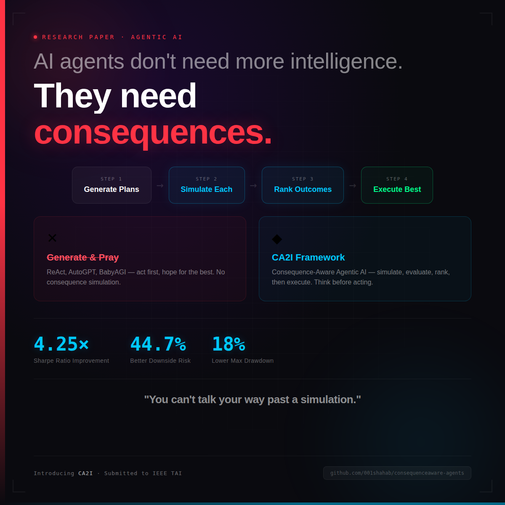

<p align="center">
  
</p>

# Consequence-Aware Agentic AI: A Pre-Execution Outcome Assessment Framework for Responsible Large Language Model Agents

**Authors:** A. A. Jafari, C. Ozcinar, G. Anbarjafari  
**Affiliation:** University of Tartu & 3S Holding OÜ, Tartu, Estonia  
**Contact:** shb@3sholding.com  
**Paper:** [arXiv:submit/7339239](https://arxiv.org/submit/7339239/view) — *Submitted to IEEE Transactions on Artificial Intelligence*  
**License:** Research use

---

## Abstract

This repository implements the complete experimental framework for studying whether an LLM agent augmented with a **consequence assessment model** (backtesting potential outcomes before execution) outperforms baseline agents that execute without consequence evaluation. The core hypothesis is that evaluating strategies on historical data before deploying them out-of-sample leads to superior risk-adjusted returns.

## Research Question

> *Does an LLM agent that assesses the potential consequences of its trading strategy selections (via historical backtesting) before execution outperform agents that select strategies without such pre-execution evaluation?*

## Methodology

### Experimental Pipeline

```
                    ┌──────────────────────────────┐
                    │     Data Pipeline (Stage 1)  │
                    │  Fetch → Validate → Clean →  │
                    │  Split (Train/Test)          │
                    └──────────────┬───────────────┘
                                   │
                    ┌──────────────▼─────────────────┐
                    │  Strategy Generation (Stage 2) │
                    │  LLM generates 5 strategies    │
                    │  per stock based on market     │
                    │  context                       │
                    └──────────────┬─────────────────┘
                                   │
                    ┌──────────────▼─────────────────┐
                    │Consequence Assessment (Stage 3)│
                    │  Backtest all 5 strategies on  │
                    │  training data (4y 7m)         │
                    └──────────────┬─────────────────┘
                                   │
                    ┌──────────────▼─────────────────┐
                    │  Strategy Selection (Stage 4)  │
                    │  Select best by Sharpe ratio   │
                    └──────────────┬─────────────────┘
                                   │
                    ┌──────────────▼─────────────────┐
                    │  Out-of-Sample Test (Stage 5)  │
                    │  Execute selected strategy on  │
                    │  held-out test data (3 months) │
                    └──────────────┬─────────────────┘
                                   │
                    ┌──────────────▼─────────────────┐
                    │  Baseline Comparisons (Stage 6)│
                    │  • Random strategy selection   │
                    │  • Buy-and-hold                │
                    └──────────────┬─────────────────┘
                                   │
                    ┌──────────────▼─────────────────┐
                    │  Analysis & Visualization      │
                    │  Statistical tests, figures,   │
                    │  comprehensive CSV outputs     │
                    └────────────────────────────────┘
```

### Stock Universe

| Ticker | Company | Sector |
|--------|---------|--------|
| AAPL | Apple Inc. | Technology |
| MSFT | Microsoft Corp. | Technology |
| TSLA | Tesla Inc. | Automotive |
| AMZN | Amazon.com Inc. | E-Commerce/Cloud |
| GOOGL | Alphabet Inc. | Technology |
| META | Meta Platforms Inc. | Social Media |
| NVDA | NVIDIA Corp. | Semiconductors |
| JPM | JPMorgan Chase & Co. | Financial Services |
| BRK-B | Berkshire Hathaway Inc. | Conglomerate |
| KO | The Coca-Cola Company | Consumer Staples |

### Data Split

- **Training period:** 2021-01-01 to 2025-07-31 (~4 years 7 months)
- **Test period:** 2025-08-01 to 2025-10-31 (3 months, strictly held out)
- **No data leakage:** Strategy parameters are never tuned on test data

### Strategy Types

1. **Moving Average Crossover** — Trend following with configurable short/long windows
2. **RSI Mean Reversion** — Buy oversold, sell overbought
3. **Bollinger Band Breakout** — Momentum breakout from volatility bands
4. **MACD Signal** — Momentum via MACD histogram crossovers
5. **Momentum** — Price momentum with trailing stops

### Key Metrics

- **Sharpe Ratio** (primary selection metric, risk-free rate = 2%)
- Cumulative Return
- Maximum Drawdown
- Win Rate
- Calmar Ratio
- Sortino Ratio
- Profit Factor

## Quick Start

### Prerequisites

- Python 3.11+
- Virtual environment (recommended)

### Installation

```bash
# Clone the repository
git clone <repository-url>
cd consequenceaware-agents

# Activate virtual environment
source myenv/bin/activate

# Install dependencies
pip install -r requirements.txt
```

### Configuration

Create a `.env` file in the project root with your API key:

```
OPENAI_API_KEY="sk-proj-your-openai-key-here"
```

The framework uses **OpenAI GPT-5.4** (`gpt-5.4-2026-03-05`) for strategy generation. If no API key is found, it falls back to a deterministic rule-based generator.

### Running the Experiment

```bash
# Activate the virtual environment
source myenv/bin/activate

# Full experiment with GPT-5.4 strategy generation (reads OPENAI_API_KEY from .env)
python main.py

# Skip LLM, use deterministic strategies (fully reproducible, no API key needed)
python main.py --no-llm

# Run on a subset of stocks
python main.py --tickers AAPL MSFT TSLA

# Custom random seed
python main.py --seed 123
```

### Expected Runtime

- Data download: ~30-60 seconds (depends on network)
- Strategy generation: ~5 seconds (rule-based) or ~60 seconds (GPT-5.4)
- Backtesting: ~30-60 seconds (50 backtests on training data)
- Random baseline (100 runs): ~3-5 minutes
- Visualization: ~10 seconds
- **Total: ~5-8 minutes**

## Output Structure

```
results/
├── data/
│   ├── AAPL_full.csv              # Full OHLCV data
│   ├── AAPL_train.csv             # Training split
│   ├── AAPL_test.csv              # Test split
│   ├── ... (for all 10 stocks)
│   ├── data_quality_reports.json  # Data validation results
│   ├── detailed_results.csv       # Complete results (all strategies × stocks)
│   ├── per_stock_comparison.csv   # Side-by-side comparison table
│   ├── summary_statistics.csv     # Aggregate metrics
│   ├── statistical_tests.json     # T-test results
│   └── statistical_tests_summary.csv
├── figures/
│   ├── equity_curve_AAPL.png      # Per-stock equity curves
│   ├── equity_curve_MSFT.png
│   ├── ... (for all 10 stocks)
│   ├── equity_curves_combined.png # All stocks in one figure
│   ├── sharpe_distribution.png    # Sharpe ratio comparison
│   ├── drawdown_comparison.png    # Drawdown analysis
│   ├── cumulative_return_comparison.png
│   ├── summary_dashboard.png      # Comprehensive dashboard
│   ├── training_heatmap.png       # Strategy selection heatmap
│   ├── sensitivity_analysis.png   # Robustness analysis
│   └── figure_manifest.json
└── logs/
    ├── experiment.log             # Human-readable log
    ├── experiment_structured.jsonl # Machine-readable structured log
    ├── experiment_metadata.json   # Run configuration
    ├── strategies_AAPL.json       # Generated strategy definitions
    ├── backtest_AAPL_training.json # Training backtest details
    ├── backtest_AAPL_test.json    # Test backtest details
    └── ... (for all stocks)
```

## Module Architecture

| Module | Responsibility |
|--------|---------------|
| `config.py` | All hyperparameters, paths, and experimental constants |
| `data_pipeline.py` | Data fetching, validation, cleaning, splitting |
| `strategy_generator.py` | OpenAI GPT-5.4 interface + rule-based fallback for strategy generation |
| `consequence_assessment.py` | Backtesting engine, performance metrics, strategy selection |
| `experiment_runner.py` | Full experiment orchestration, baselines, sensitivity analysis |
| `visualization.py` | Publication-quality figures (matplotlib) |
| `results_aggregator.py` | CSV generation, statistical tests (t-tests), summary tables |
| `main.py` | Entry point, argument parsing, pipeline orchestration |

## Design Decisions (for Reviewers)

### Why Sharpe Ratio as the Selection Metric?

Sharpe ratio penalizes both low returns and high volatility. An agent that avoids catastrophic drawdowns is more useful than one that got lucky on a single position. We also run sensitivity analysis with alternative metrics (cumulative return, Calmar ratio) to verify robustness.

### Why These Ten Stocks?

We selected stocks spanning multiple sectors (technology, finance, consumer staples, automotive) and market-cap ranges. This diversity ensures that any observed advantage of consequence assessment is not limited to a single sector or volatility regime.

### Why Rule-Based Fallback?

LLM API access is not universal. The rule-based generator produces intelligent, market-adapted strategies using the same technical analysis primitives, ensuring full reproducibility for any reviewer without API credentials. The strategies are deterministic given the random seed and market summary.

### Why Custom Backtester Instead of backtrader/zipline?

Full auditability. Every line of the backtest logic is visible and documented. No hidden assumptions in third-party library internals. We trade this convenience for transparency—a fair exchange in a research context.

### Execution Assumptions

- Long-only strategies (no short selling)
- Binary positions (fully invested or fully in cash)
- Execution at close price on signal day
- No commissions or slippage (configurable in `config.py`)
- $100,000 initial capital

## Reproducing Results

1. Use Python 3.11 with the exact versions in `requirements.txt`
2. Set random seed to 42 (default)
3. Run with `--no-llm` for deterministic reproducibility
4. All intermediate data is saved to `results/data/` for verification

## Statistical Analysis

We use paired t-tests (two-tailed, α=0.05) to compare:
- Consequence-Aware vs. Random Selection
- Consequence-Aware vs. Buy-and-Hold
- Consequence-Aware vs. Average of 100 Random Baseline Runs

We also report Cohen's d for effect size, because p-values alone don't convey practical significance.

## Sensitivity Analysis

We test robustness along two dimensions:
1. **Selection metric:** What if we selected by cumulative return or Calmar ratio instead of Sharpe?
2. **Training window:** What if we used 4y5m or 4y6m instead of 4y7m?

## Limitations

1. **Short test window:** 3 months of out-of-sample data is a limited evaluation period.
2. **Strategy space:** Five technical analysis strategy types may not capture the full range of viable approaches.
3. **No transaction costs:** Real-world friction would disproportionately affect active strategies.
4. **Long-only bias:** Bear market performance is not captured.
5. **Survivorship bias:** All ten stocks are current large-caps that survived the period.
6. **Single market:** US equities only; results may not generalize to other asset classes.

## Citation

If you use this code in your research, please cite:

```bibtex
@software{anbarjafari2025consequence,
  title = {Consequence-Aware Agentic AI: A Pre-Execution Outcome Assessment Framework for Responsible Large Language Model Agents},
  author = {Jafari, Akbar Anbar and Ozcinar, Cagri and Anbarjafari, Gholamreza},
  journal={IEEE Transactions on Artificial Intelligence},
  status = {Under Review},
  pages = {1--8},
  year = {2026}
}
```

## License

This code is provided for research and academic purposes. For commercial use, please contact the author.

---

*Developed by Prof. Shahab Anbarjafari, 3S Holding OÜ, Tartu, Estonia*
